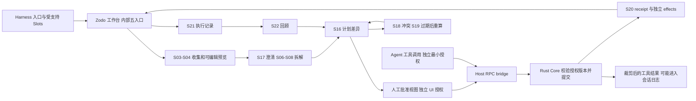

# 清晰日程 Harness 首期流转与旧图映射

版本 1.3 · 2026-10-24。首期为宿主内 Zodo 工作台、详情和批准面；并非新的独立应用外壳。今天、收集箱、目标、日程、回顾在插件内部组织；全部任务从今天/局部搜索可达，项目位于目标分段，习惯位于回顾分段。宿主全局导航、会话及快捷键保持其所有权，后续 Flutter 手机才使用独立五底栏。

箭头表示拟议交互，尚未实现。人工查询结果与 agent 工具结果是两个权限面：人工可见不等于可回模型；Core/bridge 在输出前裁剪。工具结果进入 Harness 会话后可能随历史供其他模型使用，device_only 不因当前 agent 采用本地模型就允许导出。

七张旧图仅作映射：D01≈Today，D02≈收集/详情/澄清局部，D03≈目标拆解，D04≈日程比较，D05≈回顾，D06≈模型/隐私/agent 摘要；M01 仅参考窄屏逐项确认及后续 Flutter。它们都不是 Harness 新截图。D01 两项建议和 M01 单项需形成不同提案/批准；D04 下周场景与今日候选是不同快照，不能拼成同一次排程。

生成期间保持输入可编辑/IME，取消只阻止后续生成/提交；stale 必须重算并重新批准。超时后查原 receipt，committed 与提醒/日历送达分开。宿主关闭或插件热重载时卸载 UI 订阅不删除 Core 持久事实；重开按快照/cursor/回执恢复。宿主会话和控件回放只能渲染，不自动重新 execute。原生后台/系统通知由后续平台适配验证，不由 Harness 网页承诺。

稳定 S01–S30、L01–L16、F01–F08 及逐屏覆盖以 [完整规格](../ui/01-screen-and-flow-spec.md) 和 [设置/AI 流程](../ui/02-ai-and-settings-flows.md) 为准；旧 PNG、纯文字与模拟交互分开记账。
